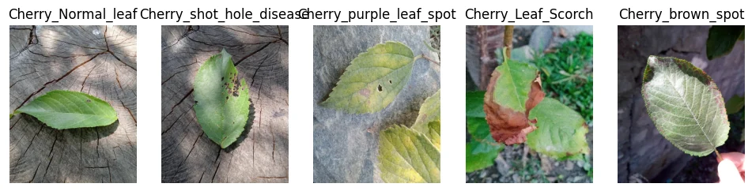
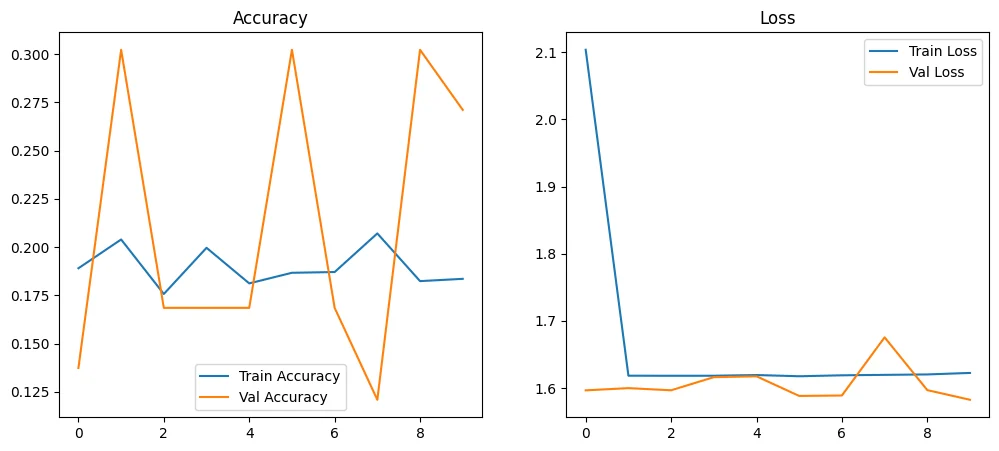
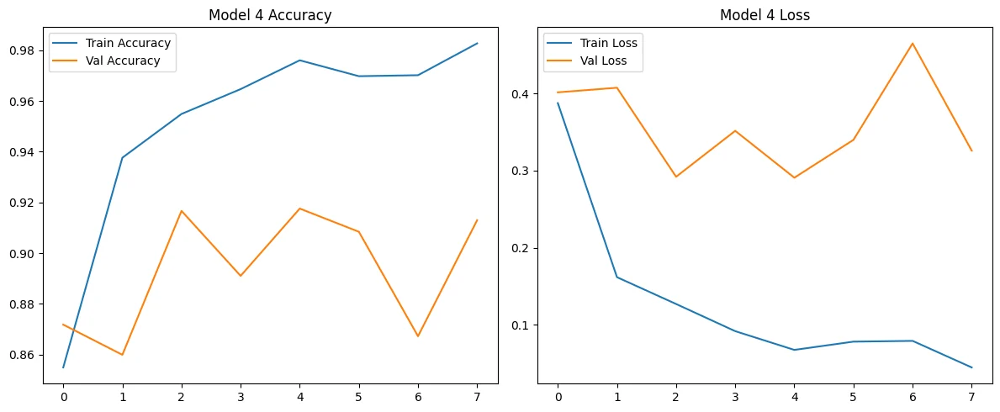
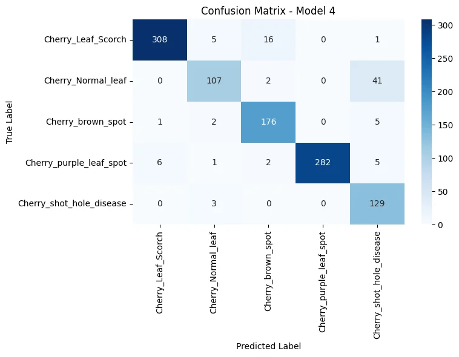
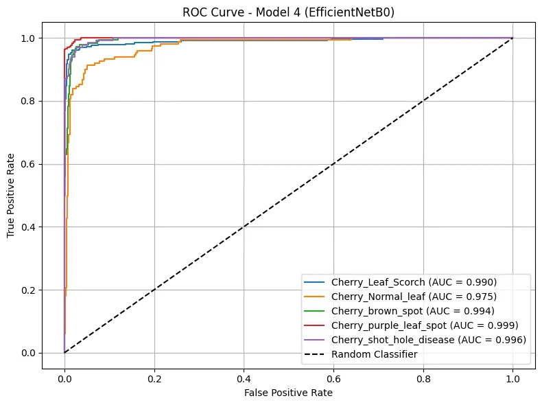

# Cherry Leaf Disease Classification — AlexNet vs EfficientNetB0

**Individual academic Deep Learning project | Computer vision | TensorFlow / Keras | Grade A**

This repository preserves the original notebook and written report for a five-class cherry-leaf image classification experiment. The workflow compares a manually implemented AlexNet-style CNN with several modifications and an ImageNet-pretrained EfficientNetB0 model. All numerical results below are taken **from saved notebook outputs**; training was **not rerun** for this repository.

## At a glance

| Dataset | Learning task | Strongest recorded model | Evaluation result |
|---|---|---|---|
| 3,642 RGB images, 5 classes | Multiclass image classification | Frozen ImageNet EfficientNetB0 with a new classification head | **91.76% accuracy**, weighted **F1 = 0.9185**, on a **shared validation/test subset** |

> **Critical evaluation caveat:** The notebook created 2,550 training samples and 1,092 samples in a single `subset='validation'`. The generator subsequently labeled **test** reused the same 1,092 images that were used for model validation. Therefore **91.76% is NOT an untouched, independently held-out test accuracy**. The original assessment requested a 70:15:15 split, but the executed notebook implements a 70:30 train/shared-evaluation split. Additionally, the final comparison applied differently scaled inputs to AlexNet and EfficientNet variants, so the five-model accuracy table is not a controlled head-to-head comparison.

## Dataset and exploratory data analysis

The original image collection is organized into five class-named folders of JPEG files, initially 800 × 1,000 pixels per image (width-to-height ratio 0.8). The recorded integrity check found **zero unreadable images**. The source images are **not included** in this public repository.

| Class label | Images |
|---|---:|
| `Cherry_Leaf_Scorch` | 1,101 |
| `Cherry_purple_leaf_spot` | 987 |
| `Cherry_brown_spot` | 614 |
| `Cherry_Normal_leaf` | 500 |
| `Cherry_shot_hole_disease` | 440 |
| **Total** | **3,642** |

These counts reveal nontrivial imbalance: the largest class has over twice as many samples as the smallest. Class weighting and realistic training-time augmentation were considered to reduce majority-class dominance.



## Preprocessing and model development

1. Review image dimensions, class balance and file integrity; resize to **224 × 224 × 3**. Note that direct square resizing alters the 800:1000 source aspect ratio.
2. For manually implemented AlexNet candidates, use pixel rescaling `1/255`, training-only geometric/brightness augmentation (rotation, shifts, zoom, horizontal flip), and balanced class weights.
3. Build a manual AlexNet-style baseline with five convolutional blocks and dense layers of 4,096 + 4,096 hidden units. The model summary reported **46,767,493 trainable parameters**.
4. Explore reduced dense layers, BatchNormalization, adjusted dropout/learning rates and monitoring callbacks (`EarlyStopping`, `ReduceLROnPlateau`).
5. Build EfficientNetB0 with `weights='imagenet'` and `include_top=False`, freeze the backbone and add GlobalAveragePooling, Dense(256), Dropout(0.2), Dense(5, softmax). Reported total parameters: **4,378,792**, of which **329,221 trainable**. The notebook used an input generator without `1/255` rescaling for this model, consistent with the built-in preprocessing in the selected Keras EfficientNet implementation.





## Model results and interpretation

The table is **transcribed from the original notebook's final comparison**; it is shown for historical transparency, not as a fair controlled test benchmark.

| Architecture | Reported evaluation accuracy | Weighted F1 |
|---|---:|---:|
| Baseline AlexNet | 0.271062 | 0.115612 |
| Modified CNN 1 | 0.244505 | 0.173440 |
| Modified CNN 2 | 0.293040 | 0.188569 |
| Modified CNN 3 | 0.120879 | 0.026072 |
| EfficientNetB0 (modified model 4) | **0.917582** | **0.918513** |

The EfficientNetB0 run reported weighted precision **0.928558**, weighted recall **0.917582**, and macro one-vs-rest ROC AUC around **0.9909** on the shared evaluation subset. Visual evaluation artifacts are preserved below.





**Why the difference?** The manually trained AlexNet was very parameter-heavy for 3,642 images, and its training accuracy stayed near chance in the recorded baseline run. Pretrained EfficientNetB0 already carries general visual representations; freezing the backbone sharply reduces the number of parameters learned from this small dataset. **But architecture is not the only changed variable:** image preprocessing and training settings also differed, and the evaluation subset was reused during selection.

## Reproduction and provenance

- Original executed notebook: [`notebooks/cherry_leaf_classification.ipynb`](notebooks/cherry_leaf_classification.ipynb).
- Submitted PDF: [`reports/original_cherry_leaf_classification_report.pdf`](reports/original_cherry_leaf_classification_report.pdf).
- Original image data: **not supplied**. See [`data/README.md`](data/README.md).
- Chart files in [`figures/`](figures/) were extracted from **embedded output images inside the original notebook**, then converted to WebP. They are **not synthetic recreations**.
- `requirements.txt` is an **illustrative** dependency list, not an environment lock; original hardware/software configuration was not reproduced.
- Notebook contains original academic identification and a coursework video link. Review those before making a public repository.

To inspect locally:

```bash
python -m venv .venv
# Activate the virtual environment for your OS
python -m pip install -r requirements.txt
jupyter lab notebooks/cherry_leaf_classification.ipynb
```

The original code expects the supplied-but-not-redistributed image directory at `data/cherry/<class-name>/*.jpg`. Without those images, the full training pipeline cannot be rerun. Exact original package versions, models and trained weights are not bundled.

## Limitations and responsible use

The shared validation/test subset means the model has **not** been assessed on an independent final holdout. The different input scaling used in the final comparison means the reported baseline-versus-EfficientNet ranking is **not a controlled apples-to-apples test**. Class prevalence, image acquisition, background artifacts and possible near-duplicate images could also influence results. The study should not be presented as a deployed agricultural diagnostic service or a validated field model.

**Next step:** use a genuine stratified train/validation/test split, identical evaluation preprocessing, and an untouched final test cohort before making production-generalization claims.
